# Natendo Data Edit

A Windows desktop editor for table files: CSV, TSV and files split by any
other character, plus fixed-width text, log files, spreadsheets and SQLite
tables. It opens a 10-million-row file in about a second, lets you edit it
like a spreadsheet, and saves it back without disturbing the rows you did not
touch.

- **No row limits, no ads, no editions, no account.**
- **Works offline.** The app never connects to the internet.
- **Fast on huge files.** 96 speed checks on a 10-million-row file all pass
  (see [Speed](#speed)).
- Built with a Rust engine and a web-style screen on Tauri 2. All code, names,
  icons and wording are original.

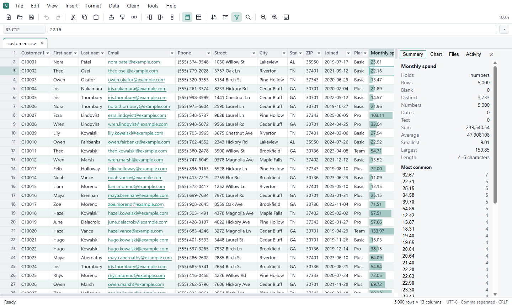
*A 5,000-row customer list with data bars on Monthly spend and the column summary beside it. All screenshots use made-up sample data.*

## Contents

- [Install](#install)
- [Speed](#speed)
- [Features](#features)
  - [Opening and saving](#opening-and-saving)
  - [The grid](#the-grid)
  - [Editing](#editing)
  - [Find, sort and filter](#find-sort-and-filter)
  - [Seeing what is in the data](#seeing-what-is-in-the-data)
  - [Checking data](#checking-data)
  - [Import and export](#import-and-export)
  - [Joining two lists](#joining-two-lists)
  - [Matching people and addresses](#matching-people-and-addresses)
  - [Reshaping tables](#reshaping-tables)
  - [Pivot tables](#pivot-tables)
  - [Cleaning tools](#cleaning-tools)
  - [Repeating your work](#repeating-your-work)
  - [Printing, PDF and labels](#printing-pdf-and-labels)
  - [Working with files and folders](#working-with-files-and-folders)
- [Privacy-safe defaults](#privacy-safe-defaults)
- [Build from source](#build-from-source)
- [Command line (`natendo-cli`)](#command-line-natendo-cli)
- [Agent link](#agent-link)
- [Known limits](#known-limits)

## Install

1. Download `Natendo.Data.Edit_0.3.5_x64-setup.exe` from the
   [Releases page](https://github.com/hamcoec-dot/NatendoDataEdit/releases).
2. Run it. It installs for your Windows account only, so it does not need
   administrator rights.
3. Setup asks whether table files (`.csv`, `.tsv`, `.tab`, `.psv`, `.dat` and
   similar) should open in Natendo Data Edit, and separately whether plain
   `.txt` files should. You can change this later in File > Options.

The installer is not code-signed yet, so Windows SmartScreen shows "Windows
protected your PC" the first time. Click **More info**, then **Run anyway**.

Needs 64-bit Windows 10 or 11. The screen uses Microsoft Edge WebView2, which
Windows 11 already has; setup fetches it on older systems if it is missing.

## Speed

Every build is timed against a generated test file of **10 million rows,
1.59 GB**, with a time limit for each job. Results measured on 13 November
2026, on a PC with an AMD Ryzen 9 9955HX (16 cores)
and 32 GB of memory: **96 of 96 checks passed.**

Opening and moving around

| Job (10 million rows) | Time |
|---|---|
| First rows on screen | 0.03 s |
| Whole file indexed and ready | 1.3 s |
| Scrolling: fetching a screenful of cells | 0.1 ms (slowest 1 in 100) |
| Memory for the index | 40 MB (2.5% of the file) |
| Jump to the end of a column (Ctrl+Down) | 0.07 s |

Sorting, filtering, finding

| Job (10 million rows) | Time |
|---|---|
| Sort by a number column | 0.24 s |
| Sort by a text column (natural order, so 2 before 10) | 1.3 s |
| Filter one column | 0.13 s |
| Find every match of a pattern in a column | 0.10 s |
| Replace all in a column | 0.57 s |
| Find duplicate rows by one column | 0.61 s |
| Remove those duplicates | 0.93 s |
| Shuffle every row | 0.11 s |
| Totals of a whole column | 0.14 s |

Saving

| Job (10 million rows) | Time |
|---|---|
| Save after editing 1,000 rows | 3.2 s |
| Save after sorting and Replace All | 3.7 s |
| Save after adding and moving columns | 6.0 s |
| Save after a 3-column join | 8.2 s |
| Save As with every value quoted | 9.2 s |

Bigger jobs

| Job | Time |
|---|---|
| Compare two 10M-row files by key | 10.0 s |
| Join a 10M-row file to another 10M-row file, 3 columns: plan and apply | 12.4 s |
| Join 1M rows to a 100,000-row list by one key | 0.12 s |
| Find near-duplicate people within 10M rows | 29.1 s |
| Match 1M people against a 10,000-person list | 0.96 s |
| Street range lookup for 10M addresses (31,100 ranges) | 3.0 s |
| Take changes from a newer copy, 10M rows | 4.7 s |
| Pivot 10M rows: city and flag by month, sum + row count + distinct count | 1.5 s |
| Pivot quick preview (first 200,000 rows) | 0.05 s |
| Pivot: change sorting, totals, show-as or formats | 0.01 s |
| Pivot with 3 million items (name by city), sum + median | 4.6 s |
| Pivot drill-down to one city's 32,000 rows | 0.26 s |
| Computed column on every one of 10M rows | 6.2 s |
| Share-safe copy of 10M rows (mask, scramble, age band) | 2.5 s |
| Search a folder holding the 10M- and 1M-row files | 10.3 s |
| Recipe of 3 column steps on 10M rows | 1.1 s |
| Export 1M rows to Excel / read them back | 4.4 s / 9.1 s |
| Save 1M rows to SQLite and open them again | 3.0 s |
| Encrypt 1M rows and open them again | 1.3 s |
| PDF of 100,000 rows | 1.8 s |
| Mailing labels for 1M rows (30 per page) | 7.5 s |

The speed checks live in `crates/engine/examples/perf.rs`; run them with
`cargo run --release -p natendo-engine --example perf`.

## Features

A look at three of the menus: almost every tool is one click away, and
everything is also in command search.

<table>
<tr>
<td width="33%"></td>
<td width="33%">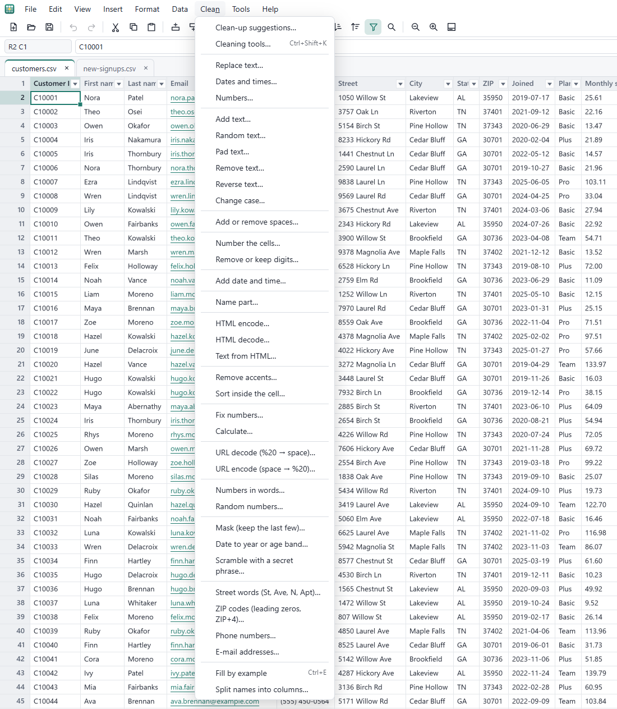</td>
<td width="33%">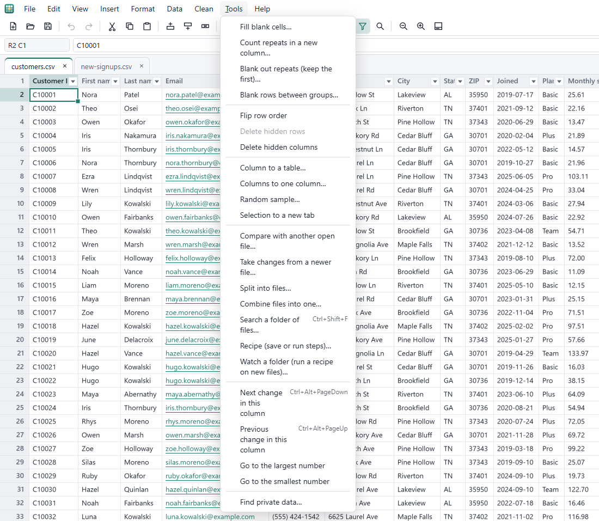</td>
</tr>
<tr><td align="center"><b>Data</b></td><td align="center"><b>Clean</b></td><td align="center"><b>Tools</b></td></tr>
</table>

### Opening and saving

- **Works out the file on its own:** the separator (comma, tab, semicolon,
  pipe, runs of spaces, control characters, even several-character
  separators), the quoting style, the text encoding (UTF-7, UTF-8, UTF-16,
  UTF-32 and older Windows code pages) and the line breaks (Windows, Unix,
  old Mac, mixed). It skips notes and `sep=` lines at the top, and when it is
  unsure it shows its confidence and the runner-up choices with a preview.
- **Text-safe saving:** rows you did not edit are written back byte for byte,
  so a save never quietly changes dates, leading zeros or quoting elsewhere in
  the file.
- **Repairs broken files:** stray or unclosed quotes and rows with too many or
  too few fields are fixed, and each repair is listed.
- **Title row or not:** the app guesses whether the first row holds titles;
  one switch changes it, and files without titles get column numbers.
  Rename a column by double-clicking its heading, right-clicking it, or
  Format > Rename column (a file without titles gets a title row). Data
  check rules that name the column ([first_name]) follow the new name (or
  its number, [#2], when another column has that name too), and undo puts
  both back. A saved pivot layout or view that names a column this file no
  longer has asks before using the column in the same place, and the view's
  rules follow. A rename is a recipe step, so recipes replay it.

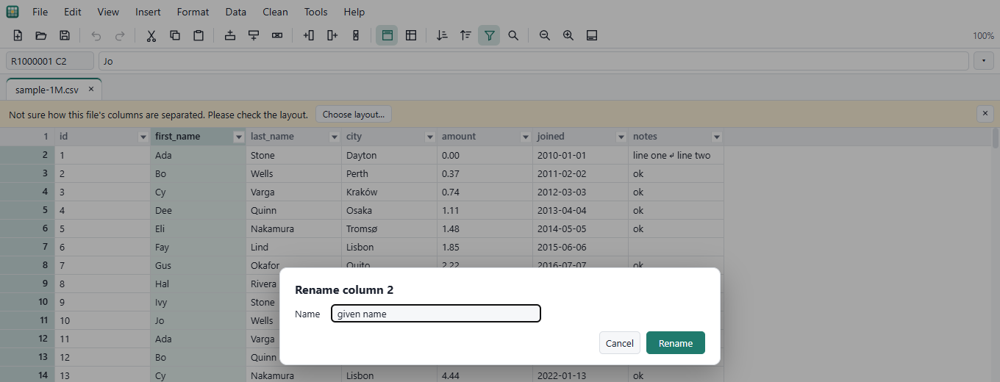
*Double-click a heading to rename the column.*

- **Save As options** with a live preview: separator, quoting (as is, only
  where needed, every value, text but not numbers), quote character, encoding
  and line breaks.
- **Never lose work:** automatic recovery copies after a crash, a list of
  earlier saves to go back to, Revert, and saves written to a temporary file
  first and then moved into place.
- **Big files:** opens files of several gigabytes; every long job shows
  progress and can be stopped.

### The grid


*Dark theme with a violet accent; numbers show in blue and dates in green (Ctrl+F8).*

- A spreadsheet-style grid that stays smooth at millions of rows, with
  **Excel's usual keyboard shortcuts** (F2, F4 to repeat, Ctrl+arrows,
  Ctrl+Shift+L for filters, Alt menu keys and the rest).
- **The active cell stays put**, as in Excel and Google Sheets: after
  Shift+arrows, Ctrl+Shift+arrows, Shift+click, Shift+Space or Ctrl+Space
  the cell you started from stays active (typing goes there), and a plain
  arrow key then moves on from it. Ctrl+Shift+Down then Down lands one row
  below where you started, not at the bottom.

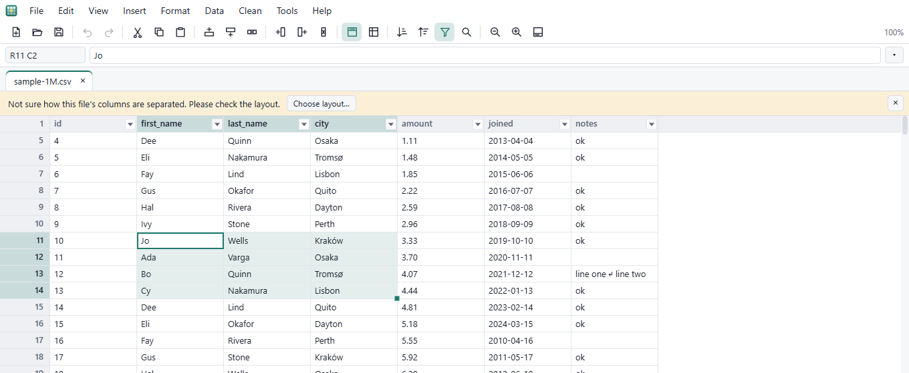
*Shift+Down three times and Shift+Right twice: Jo, where it started, is still the active cell (R11 C2).*

- Tabs for each open file, frozen rows and columns, insert, delete, move,
  hide, resize and auto-fit columns, hide and show rows (Ctrl+9,
  Ctrl+Shift+9).
- **Drag to move and arrange**, as in Google Sheets: reorder or rearrange
  columns by dragging their selected headings, or rows by their selected
  numbers; drag a selected block of cells by its outline to move it (Ctrl+drag
  copies it, Esc stops a drag). Resize or double-click-fit several selected
  columns at once, click the small arrow beside hidden columns to show them
  again, drag the edges of the top-left corner to freeze rows or columns, and
  drag file tabs into another order (the tab follows the pointer and the
  others slide aside to show where it will land; Esc puts it back;
  Ctrl+Shift+PageUp/PageDown moves the shown tab from the keyboard). Each move is one undo step, and colour
  scales, highlight rules and checks move with their columns. Help > Mouse
  and drag moves lists them all.
- Light, dark or system theme with an accent colour, font and font size, zoom.
- Alternating row colours, wrapped text, row height in lines.
- **Display formats** per column (numbers, percent, currency, dates, tick
  boxes) that change only how cells look, never the file.
- Value types shown in colour (Ctrl+F8), colour scales and data bars.
- Ctrl+click opens web and e-mail addresses.
- **Command search** (Alt+Q, the same key as Excel's search box; change it
  under Help > Customize shortcuts): type a few letters or words and every
  matching tool shows at once, with the menu it lives in and a line from this
  page saying what it does. Everyday words work too ("dedupe", "vlookup",
  "trim", "mail merge"), and small typing slips are forgiven. Arrows and Enter
  or a click open the tool; Esc or Alt+Q again closes.
- Custom shortcuts, Ctrl+/ for the list of shortcuts (with a Mouse section:
  every drag and click move), a file browser panel, an activity panel, and a
  start page with recent files. File > Open recent (Ctrl+Shift+O) shows the
  same list at any time: tick two or three files and each opens in its own
  tab, or middle-click files one after another to open each in a new tab
  while the list stays open (middle-clicking a file on the start page works
  the same way). Up and Down move through the list and Enter opens. Files
  that are already open are marked "open" and switched to, never opened
  twice; two files with the same name show enough of their folders to tell
  them apart (2024\Data, 2025\Data), in the list and on their tabs.


*File > Open recent after a few middle-clicks: each opened in its own tab and is marked "open".*

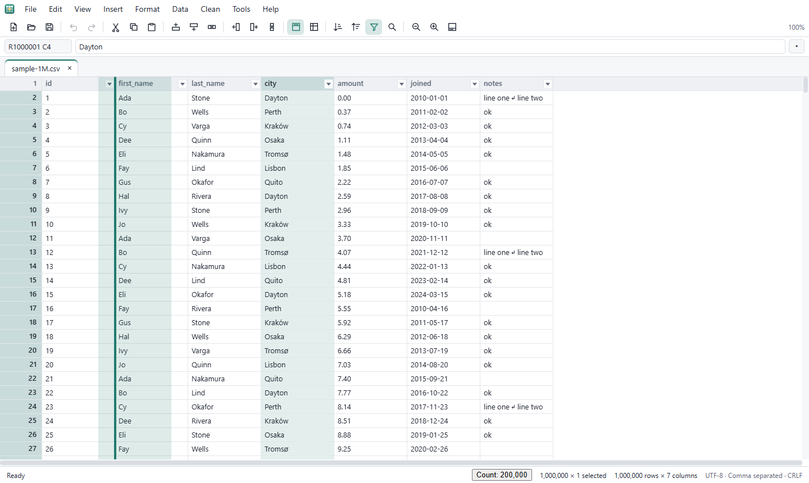
*Dragging "city" by its heading: a see-through band follows the pointer and the bar shows where it will land.*

### Editing


*first_name is cut (dashed outline); right-clicking city offers "Move what was cut here", which puts it before city in one step.*

- **Cut and paste that moves**, as in Excel and Google Sheets: Ctrl+X marks
  whole columns, whole rows or a block of cells with a dashed outline and
  changes nothing yet; pick a column (or row, or cell) and Ctrl+V moves them
  there in one undo step. Cut columns go in before the column picked and cut
  rows above the row picked, and the gap they leave closes up, so there is no
  empty column to insert or delete by hand. Esc cancels. The right-click menus
  of cells, row numbers and column headings have Cut, Copy, Paste, Move what
  was cut here and Cancel cut.
- Edit in the cell or in a larger, multi-line edit box; a cell bar with a
  "Go to" box.
- **Typing moves like Excel:** after typing in a cell, an arrow key keeps
  what you typed and moves on (F2, or a double-click, edits inside the text
  instead, and F2 switches between the two). Enter and Tab move through a
  selected block without losing it, wrapping at its edges, and Tab, Tab,
  Enter goes to the next row in the column you started from.

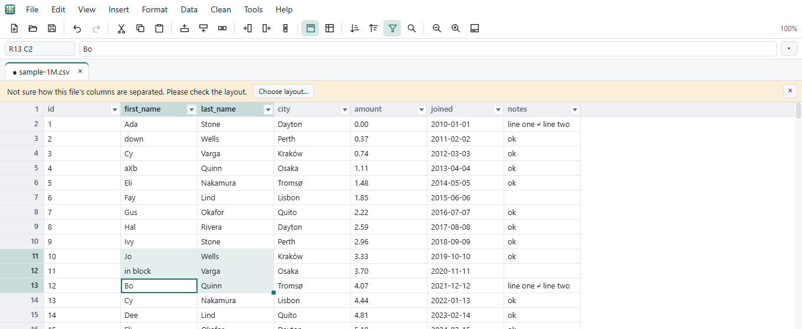
*Typing into a selected block: Enter moves to the next cell of the block, which stays selected.*

- **Insert and delete cells** as in Excel: Ctrl+Plus or Ctrl+Minus on part
  of a row asks whether to shift the other cells (right or down when
  inserting, left or up when deleting) or take the entire rows or columns;
  whole rows or columns selected go straight away. The cell right-click menu
  has Insert cells… and Delete cells… too.

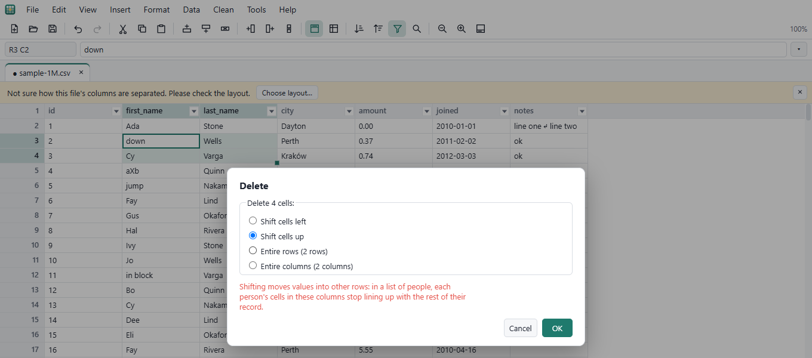
*Ctrl+Minus on two rows of two columns, with Shift cells up picked: the box warns that values move into other rows.*

- **Clear or fill big selections:** Delete clears and Ctrl+Enter fills a
  selection of up to 5 million cells, or whole columns of any length, as one
  undo step with a progress bar; whole columns down to the last row (with no
  filter on) clear at once however many rows there are, and List of my
  changes shows them as cleared.
- Fill handle, fill series, Ctrl+Enter to fill a whole selection, Paste
  Special (values only, swap rows and columns), special characters.
- **Type-ahead suggestions** from the column's own values, **pick-from-list
  cells** (Alt+Down) for columns with a list check, a calendar pop-up for
  dates, spell check.
- Undo and redo for everything, including big jobs on millions of rows,
  in the order you did things: edits and every tool, sorts, **filters**
  (Filter, Show duplicates, show rows with problems or notes, Clear filter),
  hiding rows and columns, column widths and AutoFit, display formats and
  wrapping, row height, highlight rules, colour scales, banding, the group
  line and data checks. Applying a saved view is one step. A deleted column
  comes back with its width. Filters
  and the look of the table do not count as unsaved changes.
- One-row-per-page form view.
- **List of my changes** (Edit menu): every cell that differs from the saved
  file (was / now), rows and columns added, deleted or moved; click to jump
  there, or save the list as a report. View > Show my edits marks changed
  cells.
- **Notes and coloured flags on rows** (Shift+F2). They are kept in a small
  file beside the table, so the table itself never changes, and they follow
  their rows through sorts, filters and newer copies of the file. Filter to
  rows with a note or one flag colour.
- Read-only lock for a file you only want to look at.

### Find, sort and filter


*Filter by value: every city with how many rows it has, plus sorting and conditions.*

- Find and replace with plain text, wildcards or patterns (regular
  expressions); next change, largest and smallest jumps.
- **Search a whole folder** of table files (Ctrl+Shift+F), including Excel and
  JSON files and subfolders; click a hit to open that file at that cell.
- Sort by several columns, numbers and dates in the right order, natural text
  order, by length, by last word, or in your own custom order. Flip or shuffle
  rows. Sort the columns themselves by their titles.
- Quick filter, a filter builder for more complex rules, and largest or
  smallest N (rows or percent).
- **Saved views:** filters, column layout, highlight rules and checks saved
  under a name and applied to other files (columns are matched by title; one
  not found is offered from the same place, and the view asks first).
- Find duplicate rows, and remove them keeping the first, last, newest,
  oldest or most complete copy, filling blanks from the other copies.
- **Column lists start empty:** wherever you tick columns (duplicates, merge
  rows, subtotals, joins, group figures, charts and the rest), nothing is
  ticked until you choose, and Select all / Unselect all tick or clear them
  all at once.

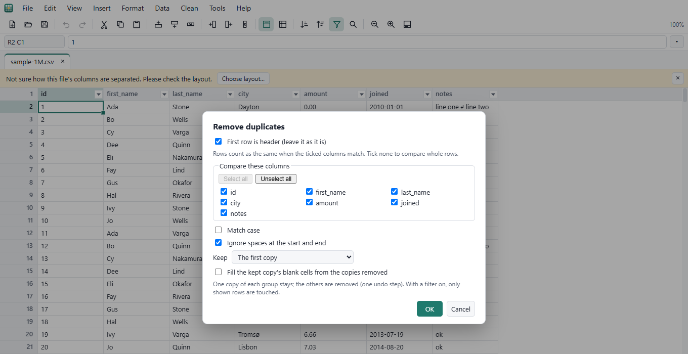
*Select all ticks every column; Unselect all clears them.*


### Seeing what is in the data


*Count of values on the Plan column, drawn in the side panel.*

- **Summary of each column:** type, count, blanks, distinct values, smallest,
  largest, average, total and the most common values.
- **Quick totals** of the selection (sum, average, count, numbers, smallest,
  largest, different values, characters), with one click to copy a total.
- Charts (line, bar, pie, counts), subtotals and groups, highlight rules.
- **Compare two open files**, by a key column or by whole rows: what was
  added, removed and changed.
- Random sample into a new tab.
- **Value editor:** every value in a column with its count; rename or merge
  values, group look-alikes ("Main St" / "Main Street"), or apply a
  translation list.

### Checking data

- **Data checks** per column or row: required, number (with limits, whole
  numbers), date (with limits), length, from a list, pattern, no repeats, or
  your own expression. Cells that fail are marked; show only the rows with
  problems. Checks are saved with views and can run from the command line.
- **Check fields with patterns:** one simple screen with a pattern box next to
  each column and ready-made patterns (e-mail, ZIP, phone, web address,
  letters, digits). Then show the rows that fail or pass, put failing rows
  first, or add a column saying `OK` or what failed.
- **Clean-up suggestions:** spots extra spaces, mixed case, stray characters
  and similar problems and offers a one-click fix.

### Import and export

- **Open:** Excel (`.xlsx`) and LibreOffice (`.ods`) sheets, JSON, XML, HTML
  tables, Markdown tables, fixed-width files (with a ruler you can drag), and
  log files (by a line pattern with presets; stack traces join the line
  above). From a file or from the clipboard, with a preview.
- **SQLite:** open a table or view from a SQLite database (read-only), or
  save the table into a new or existing database.
- **Export:** Excel, JSON, XML, HTML, Markdown, fixed width, PDF, SQL
  statements (standard SQL, MySQL, or SQL Server/Access style) or a template
  of your own; to a file or the clipboard, with a preview.
- **Split one file into many** (by a column's value or a row count) and
  **combine many files into one**.
- **Append** the rows of another file.
- **Encrypted copies** (`.ndenc`): a password-protected copy that opens only
  in this app, straight into memory, never to disk.

### Joining two lists

<p align="center">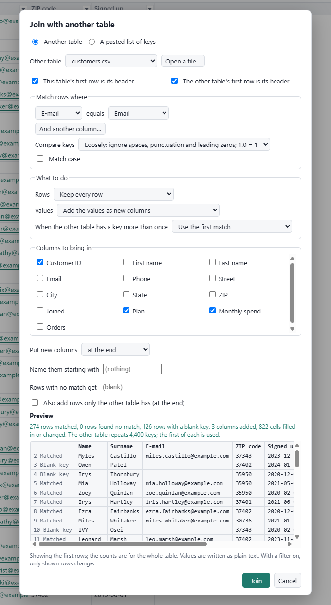</p>

*The Join screen: bring a customer number, plan and spend into a sign-up list by e-mail, loosely matched, with a live preview of every row.*

Bring in columns from another file or tab by a shared key, with a live
preview:

- Add new columns, or **update existing ones** (overwrite, or fill blanks only).
- Keep every row, **only matched rows, or only unmatched rows**; check rows
  against a list of keys pasted in or from another tab.
- **Repeated keys:** take the first, last, every match, all in one cell, a
  count, sum, smallest or largest.
- **Loose keys:** ignore leading zeros, punctuation and `1.0` versus `1`.
- **Nearest key:** the nearest smaller or larger key, for tiers, bands and
  date periods.
- Text for rows not found, where new columns go, and a prefix for their names.
- `LOOKUP` inside computed columns, and `natendo-cli join` for scripts.

### Matching people and addresses

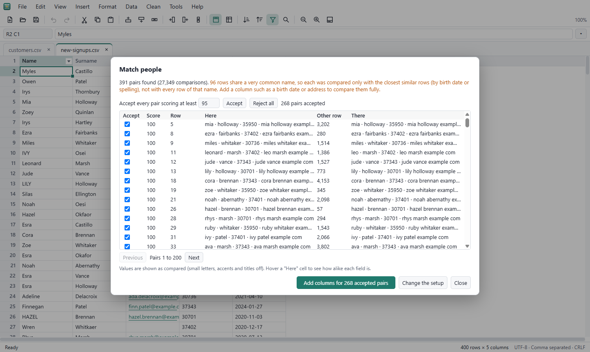
*Matching a sign-up list against the customer list: Leonard is paired with Leo, Myles with Miles, typos and capitals are forgiven. Tick the pairs to keep.*

- **Match people** across two lists, or find **near-duplicates** in one list,
  even when names are written differently: nicknames (Bill / William),
  initials, word order, titles, accents and typing slips; dates in any layout
  (with day and month swapped counting partly); ZIPs, phones and IDs by their
  digits. Jr, Sr, II and III are kept apart. Each pair gets a score; review
  them best first and accept each one, or every pair above a score.
- **Street range lookup:** find the precinct, district or ward for each
  address from a street index of house number ranges, with odd and even sides
  and ZIP or city to tell same-named streets apart. `North Main Street`,
  `N. Main St., Apt 4` and `N MAIN ST` all count as the same street. A note
  column explains any address it could not place.
- **Take changes from a newer file:** pairs rows by key columns and lists
  every changed cell, new row and missing row; tick which to take, and they
  go in as one undo step.

### Reshaping tables

- Split and merge columns and rows, unpivot, column to a table, columns to
  one column. (Pivot tables have their own section below.)
- **Smarter split:** at the last separator, at any of several, at fixed
  positions, or between letters and digits.
- **Extract** a number, e-mail, ZIP, phone number, text in brackets, words or
  a unit into a new column.
- **Choose and order columns:** keep, delete, reorder and rename in one step.
- **Computed columns** with Excel-like expressions (values saved as text).
- **Build a column without a formula:** from a template, or from if-then rules.
- **Group figures** in a new column: count, sum, average, smallest, largest,
  first, last, rank, running count, percent of group.
- Remove blank rows and columns, delete hidden rows and columns, blank rows
  between groups, a line at each change.
- Fill blank cells (from above, below, or a text), count repeats, blank out
  repeats.

### Pivot tables


*Sales by region, rep and product for 2026, built by dragging fields. North is collapsed; double-clicking a number lists the orders behind it.*

- **Pivot table builder:** drag fields into Rows, Columns, Values and Filters
  (or click R, C, Σ or F next to a field) and the result updates as you go,
  like Excel. On a big file a quick preview from the first 200,000 rows shows
  first, clearly marked, then the full result.
- **Count or add up any combination:** as many row, column and value fields as
  you like. Count (cells not blank, every row, numbers only, blanks), distinct
  count (different values; like row items, "Ann" and "ann " count once
  unless case or spaces are set to matter), sum, average, smallest, largest, median, standard
  deviation, variance, product, first, last, or a list of the values. Number
  columns start as Sum and text columns as Count.
- **Group dates and numbers:** years, quarters, months, year and month, days,
  days of the week, hours, or number ranges of any size.
- **Filter and sort items:** tick the items to use, add report filters, filter
  by label (begins with, contains, between...) or by value (more than,
  between...), keep the top or bottom N, and sort by name or by any value.
  Totals leave filtered-out items out.
- **Totals and show values as:** grand totals and subtotals on or off, on the
  group's row or on a Total row below; show values as a % of the grand,
  column, row or parent total, running total, difference from the previous
  item, rank or index; decimals, 1,000 separators, currency signs.
- **Expand, collapse and drill down:** open or shut any group, or all of them;
  double-click a number to get the rows behind it in a new tab.
- **Use the result:** open it as a new tab (save or export it like any file)
  or copy it; save the layout and reuse it on next month's file (columns are
  found by their titles; a title not found, after a rename say, is offered
  from the column in the same place, and you choose), or run it with
  `natendo-cli pivot`. Data > Pivot table on a pivot tab reopens its layout.
  Sums are exact (no rounding drift) and a pivot never changes the file.


*A layout saved when column 4 was "city" asks before using it now that it is "town".*

### Cleaning tools


*Every cleaning step shows a before-and-after preview before anything changes.*

Dozens of cleaning steps, each with a live preview on a sample, for a cell
selection, a column or the whole table:

- Replace text, dates and times, or numbers; add, pad, remove, reverse or
  random text; add or remove spaces, numbers, dates and times.
- Change case, including proper name case (McDonald, O'Brien) and titles with
  small words kept lower case; split names into parts.
- Remove accents, invisible characters and odd spaces; HTML encode and
  extract; web address encode and decode.
- Fix numbers stored as text, calculate inside cells, sort inside a cell,
  numbers written in words, unique random numbers, write display formats into
  cells.
- Dates read in a layout you give, two-digit years, Julian dates.
- **Address, ZIP, phone and e-mail tidy:** USPS-style abbreviations (or
  written out), ZIP+4 and lost leading zeros, phones in the style you choose
  with extensions kept, and e-mails lower case with stray brackets removed.
- **Fill by example** (Ctrl+E): type a few results and the app fills the rest
  of the column in the same pattern.
- **Masking:** mask all but the last few characters, turn dates into a year or
  an age band, or scramble with a secret phrase (the same value always gives
  the same scramble, so joins and counts still work).

### Repeating your work

- **Cleaners:** save a list of cleaning steps and run it on any file, in the
  app or from the command line.
- **Recipes:** the app notes the steps you take on a tab (sorts, filters,
  column changes, Replace All, cleaning, computed columns and more). Save them
  as a recipe and run it on next month's file in one go; it warns you if the
  columns are different. Also from the command line.
- **Watched folder:** while the app is open, files dropped into a folder are
  run through a recipe and written to a results folder. The files dropped in
  are never changed.

### Printing, PDF and labels

- Print with page setup and print preview (Ctrl+P); landscape, margins,
  repeating title row.
- **Save as PDF** at any size, written by the app itself.
- **Mailing labels** on six common sheet sizes, starting part-way through the
  first sheet, and **one letter per row**, from a template with
  `{Column title}` fields. Empty lines are left out and text shrinks to fit.

### Working with files and folders

- Opens files from double-click, "Open with", drag and drop, or the command
  line, each in a new tab of the running window.
- Can be the default app for table files (chosen during setup or later).
- Save all, revert, rename, show in Explorer, copy the path, close unchanged
  tabs.

## Privacy-safe defaults


*The app spots e-mail, phone and street columns and starts them on safe choices for a share-safe copy.*

- **No internet.** No update checks, no usage reports, no account.
- **Agent link is off.** When switched on, it listens only on this computer,
  needs a random key, and can read but never change data.
- **Log files never hold cell contents**, only what was opened, saved or went
  wrong. Five files of at most 1 MB (Help > Open the log folder).
- **Private data warnings are on.** Tools > Find private data spots columns
  that look like Social Security numbers, birth dates, phone numbers, e-mail
  addresses, street addresses or licence numbers. Before you export, print,
  save as PDF, Save As or copy a large block that touches such a column, the
  app warns you and offers a share-safe copy.
- **Share-safe copy** (File > Save a share-safe copy): per column, keep, leave
  out, mask (`***-**-6789`), year only, age band, or scramble with a secret
  phrase. Likely private columns start on safe choices. The phrase is never
  saved.
- **Private file mode** (File > Private file mode, for a file or a whole
  folder): no recovery copies, no earlier saves, not in recent files, hidden
  from the agent link, and the clipboard is cleared when the tab closes. Tabs
  made from a private tab are private too.
- **Encrypted files** use ChaCha20-Poly1305 with a password stretched by
  PBKDF2 (600,000 rounds); they are decrypted in memory only.

## Build from source

You need, on Windows:

- Node 22 or newer
- Visual Studio 2022 Build Tools with "Desktop development with C++"
- Rust via rustup (`stable-msvc`)

```
npm ci                 # install JavaScript packages
npm run dev            # run the app with live reload
npm run build          # build the app, the command line and the installer
npm test               # screen tests
cargo test --workspace # engine, command line and app tests
pwsh scripts/ci.ps1    # every check (add -UiOnly to skip Rust)
cargo run --release -p natendo-engine --example perf   # the 10-million-row speed checks
```

The installer lands in `target/release/bundle/nsis/`.

| Folder | What is in it |
|---|---|
| `crates/engine` | The data engine: load, parse, edit, save, import, export, PDF. No screen code. |
| `crates/cli` | `natendo-cli`, the command line. |
| `src-tauri` | The desktop app shell: commands, window, file types, agent link, logs, installer. |
| `ui` | The screen (Vite, Svelte 5, TypeScript). |
| `docs/screenshots` | The screenshots in this README (made-up sample data). |
| `scripts` | Helper scripts: the CI check (`ci.ps1`), browser UI tests for the command search and pivot builder, and `build-icons.py` for the icon files. |
| `assets/icon.svg` | Source for the app icon (a grid with the active cell highlighted). `assets/icon-small/` holds hand-drawn 16, 20 and 24 px versions that stay sharp in the taskbar; if the design changes, redraw them to match (or delete them, and the build script falls back to shrinking the big image). To rebuild the icon files after changing the SVG: render it to a 1024 px PNG, run `npx tauri icon <png> -o src-tauri/icons`, delete the `android` and `ios` folders it makes, then run `python scripts/build-icons.py <png>` (needs Pillow) to add the 20 and 40 px Windows sizes and the hand-drawn small frames. Also copy the SVG to `ui/public/favicon.svg`. |

## Command line (`natendo-cli`)

Installed next to the app, for scripts and scheduled jobs. Add `--json` to get
JSON output. `validate` exits with 1 when it finds problems and 2 on failure.

```
natendo-cli info data.csv --json
natendo-cli view data.csv 0 20 --json
natendo-cli convert data.xlsx -o data.csv        # to csv, tsv, psv, json, xml, html, md, xlsx, pdf, sql, fixed (.prn)
natendo-cli convert data.csv -o data.pdf --landscape
natendo-cli compute data.csv -o out.csv --expr "[Price] * [Qty]" --title Total
natendo-cli validate data.csv --checks checks.json --json
natendo-cli join data.csv other.csv -o out.csv --key ID --columns Phone,Email
natendo-cli clean cleaner.ndclean data.csv -o out.csv
natendo-cli run monthly.recipe.json data.csv -o out.csv   # --dry-run lists the steps
natendo-cli pivot by-city.ndpivot data.csv -o summary.csv # a layout saved in the pivot builder
natendo-cli app tabs                              # needs the agent link
```

A checks file is what Data > Data checks > Save writes, for example
`{"checks": [{"column": "Email", "kind": {"type": "pattern", "pattern": {"text": "[^@]+@[^@]+", "kind": "regex"}}}]}`.
Kinds: `required`, `number`, `date`, `length`, `list`, `pattern`, `unique`,
`expression`.

## Agent link

File > Options > Agent link (off by default) lets programs on this computer
read the open tables: list tabs, read cells, open a file in a tab, move the
cursor. It cannot change data. It listens on 127.0.0.1 only; the port and a
random key are in `%APPDATA%\com.natendo.dataedit\agent.json`, and every
request must carry the key. Requests are one JSON object per line:

```
{"key": "...", "cmd": "tabs"}
{"key": "...", "cmd": "read", "tab": 1, "row": 0, "count": 100}
{"key": "...", "cmd": "open", "path": "C:\\data\\file.csv"}
{"key": "...", "cmd": "goto", "tab": 1, "row": 250, "col": 3}
```

## Known limits

- The installer is not code-signed (needs a certificate), so SmartScreen warns.
- Windows only for now.
- Microsoft Access files (`.accdb`, `.mdb`) cannot be opened directly, because
  reading them needs Microsoft's Access driver. Export SQL statements in
  SQL Server/Access style, or CSV, and import those into Access.
- Password-protected Excel files are not opened.
- Formulas, cell colours and comments are not stored in the file, because a
  text table cannot hold them. Computed columns save their values as text;
  highlight rules and checks are kept in saved views.
- PDF output does not include Chinese, Japanese or Korean characters yet.
- Dragging or cutting and pasting a block of cells moves up to 50,000 cells
  at once (Ctrl+drag copies up to 100,000); whole rows and columns have no
  such limit. Rows cannot be moved while a filter is on.
- Undo does not cover: saving (it is not a step, and changes to the data
  made before a save cannot be undone after it, as the file is rewritten;
  changes to the look still can), opening, closing and moving tabs, scrolling, zoom and the
  theme, frozen rows and columns, the "First row is header" switch (it
  changes how the file is read, not the data; Rename column's added header
  row is the exception and undoes as before), Show value types and Show my
  edits (they only show things), and Options. These match Excel and Google
  Sheets, where views, settings and saving are not undo steps either.
- The watched folder stops when the app closes, and recipes with a scramble
  step cannot run there or from the command line (the phrase is never stored).
